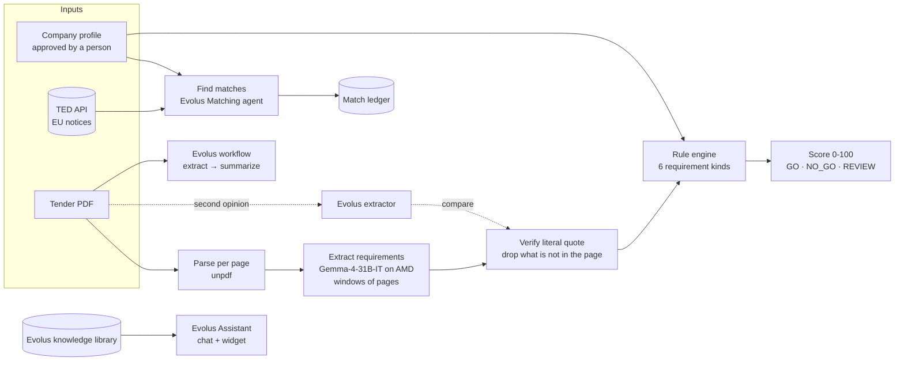

<div align="center">


# Gara Facile

**Public tenders, made easy.**
Find EU tenders that fit your company, read the 100-page PDF for you, and show exactly where you meet or miss each requirement, with the page and the literal quote.

[](https://nextjs.org)
[](https://react.dev)
[](https://www.typescriptlang.org)
[](https://www.amd.com)
[](https://evolus.ai)
[](LICENSE)

*Built for the AMD Developer Hackathon ACT III (lablab.ai), track **Evolus Business Agents on AMD**.*

</div>

---

## The problem

A small Italian company can win public contracts, but the tenders are hard to find and slow to read. A tender pack is easily 100 pages of Italian legal text. Somewhere on page 17 it says you need ISO 27001, and on page 21 it asks for a bid guarantee of exactly €6,720. Miss one line and the offer is excluded.

## What Gara Facile does

1. **Profile.** You describe your company once: what you offer, where you work, your capacity and experience, plus supporting documents. A person approves it.
2. **Matches.** *Find matches* pulls active notices from the EU's **TED** API and asks an **Evolus** agent to score each one against your profile (`exact`, `partial`, `none`).
3. **Compliance matrix.** For a tender PDF, the app extracts the participation requirements and checks each one against your company facts. Every row carries the **page** and the **literal quote** it came from.
4. **Assistant.** An Evolus agent with a knowledge library answers questions like *"Do we have ISO 27001?"* and cites the source file.

> **The model never decides eligibility.** Language models read and summarize. A fixed, tested rule engine produces `MEETS`, `FAILS` or `MISSING_DOC`, a deterministic score and a `GO` / `NO_GO` / `REVIEW` verdict. A human approves anything that leaves the system.

## How it works



The six requirement kinds the engine understands: `certification`, `min_turnover`, `bid_guarantee`, `similar_projects`, `execution_deadline`, `submission_deadline`.

## Measured results

All numbers below were measured on 17-18 Oct 2026 against three real TED tenders and one fictional company (*Nordest Software S.r.l.*, calibrated to give 2 red and 1 green).

| Tender | Verdict | Score | Rules (meets / fails) | Analysis time | Tokens |
|---|---|---|---|---|---|
| 629600-2026 · custom software services | `NO_GO` | 13 | 1 / 5 | 31.1 s | 33,393 |
| 687674-2026 · servers, installation, configuration | `GO` | 100 | 3 / 0 | 23.9 s | 45,910 |
| 691579-2026 · municipal fines management, Alatri | `NO_GO` | 53 | 6 / 4 | 57.1 s | 61,414 |

Model reported by the endpoint: `self-dploy/Gemma-4-31B-IT`.

**Evolus blocks** (workspace on the Developer Event trial, 50,000 credits):

| Block | Result |
|---|---|
| Model connection test (Gemma-4-31B-IT) | answer 1222 ms · tool calling 2851 ms · streaming 3421 ms |
| Assistant · *"Abbiamo la certificazione ISO 27001?"* | says no, only ISO 9001:2015 is listed, cites the company sheet |
| Extractor · tender 691579-2026 | 8 requirements with page and quote in about 2.5 minutes; all 8 match ours (±1 page) |
| Workflow · *Tender intake* | Completed in 68.6 s, 3 steps, Italian summary with page numbers |
| Matching agent · 2 candidate notices | 6.9 s, valid JSON, software notice `partial` 70, food-supply notice `none` 0 |
| **Credits used** | **0 of 50,000** (every step runs on our own model) |

## AMD and Evolus

- **Model.** Every chat and extraction call, in our own code and in Evolus, goes to **Gemma-4-31B-IT** served on AMD infrastructure through an OpenAI-compatible endpoint (AMD Token Factory on AMD Radeon Cloud). Evolus connects it as a *bring your own model* server, so agents, the extractor and the workflow run only on that model. The only other model in play is the embedding model Evolus uses to index the knowledge library (`text-embedding-3-small`).
- **Evolus building blocks used:** agent with RAG knowledge library, a second agent for matching, a data extractor, an API-triggered workflow, and the chat widget. The app calls all of them over REST.
- **Honest note on the track rule.** The track asks for an open model on *your own* vLLM endpoint in AMD Developer Cloud. We reach AMD-served Gemma through Token Factory; our account had no droplet credits for a dedicated MI300X. The vLLM launch scripts for that setup are in [`infra/amd`](infra/amd).

Details, IDs and a reproduction recipe: [`gara-facile/docs/evolus.md`](gara-facile/docs/evolus.md).

## Quick start

Requirements: Node.js 22+, [Bun](https://bun.sh) 1.4.2.

```bash
git clone https://github.com/ElAdagioDeJP/Hackathon-NT.git
cd Hackathon-NT/gara-facile

bun install --frozen-lockfile
cp .env.example .env          # then fill in the keys, see below
bun run db:generate
bun run db:migrate
bun run dev
```

Open <http://localhost:3000>. In the form, **Load example** fills a fictional company so you can walk through the flow.

### Docker

```bash
docker compose -f gara-facile/docker-compose.yml up --build
```

The compose file at the repository root is the entry point for Dokploy: it exposes port 3000 on the internal network (no host port), persists the database and uploads in volumes, and has a healthcheck.

### Environment

Secrets live only in `gara-facile/.env`, which is git-ignored. See [`.env.example`](gara-facile/.env.example) for every variable.

| Group | Variables |
|---|---|
| TED | `EU_API_KEY` |
| LLM (OpenAI-compatible) | `LLM_*` base URL, model and key per role |
| Evolus | `EVOLUS_API_KEY`, `EVOLUS_APP_ID`, `EVOLUS_AGENT_ID`, `EVOLUS_MATCH_AGENT_ID`, `EVOLUS_EXTRACTOR_AGENT_ID`, `EVOLUS_EXTRACTOR_ID`, `EVOLUS_WORKFLOW_ID`, `EVOLUS_LIBRARY_ID`, `EVOLUS_WIDGET_TOKEN` |
| Documents | `FILES_STORAGE_PROVIDER` = `local` or `r2`, plus `R2_*` for Cloudflare R2 |
| Database | `DB_FILE_NAME` |

## API

| Method and path | What it does |
|---|---|
| `POST /api/ai/analyze` | Requirements → rules → score and verdict for a tender and a company |
| `GET /api/ai/health` | Checks the model endpoint |
| `POST /api/ai/chat` | Chat with the Evolus Assistant (keeps `conversationId`) |
| `POST` · `GET /api/ai/evolus/extract` | Evolus extractor as a second opinion; runs in the background, cached, compares with our extraction |
| `POST /api/ai/evolus/workflow` · `GET …/{executionId}` | Starts and reads the *Tender intake* workflow |
| `POST /api/ai/evolus/library/sync` | Uploads the company sheet to the knowledge library |
| `GET` · `POST` · `DELETE /api/business-records/{id}/documents` | Profile documents on local disk or Cloudflare R2 |

Server Actions behind the profile form handle saving, approval and *Find matches*.

## Project layout

```
gara-facile/
  app/
    business-profile/        profile form and matches panel
    api/ai/                  analyze · chat · evolus/* · health
    api/business-records/    documents API
    services/
      ai/                    pdf · extract · normalize · rules · scoring · Evolus client
      match/                 TED search + Evolus Matching agent
      files/                 local and Cloudflare R2 storage
      business/              profiles and approvals
    db/schema.ts             Drizzle + SQLite
  fixtures/                  3 real tenders, fictional company, labelled requirements
  docs/                      evolus.md · matching-agent.md · files-api.md · ADRs
infra/amd/                   vLLM launch scripts for a dedicated AMD GPU
docker-compose.yml           Dokploy entry point
```

## Tests

```bash
cd gara-facile
bun run test:ai          # 45 tests: extraction, rules, Evolus blocks, library
bun run test:match       # TED + Matching agent
bun run test:profiles
bun run test:files
bun run db:check         # migrations on a new and on a populated database
bun run lint
```

## Design principles

- **Evidence or nothing.** A requirement without a page and a quote that appears in that page is dropped.
- **Rules, not vibes.** Eligibility is code with tests. The model only reads.
- **A human approves.** Profiles, matches and any draft are approved by a person; nothing is sent automatically.
- **Only measured numbers.** Figures in this README come from runs, not estimates.
- **Secrets stay out.** Keys live in `.env` and never reach the browser.

## Status

Working today: profile and document upload, TED matching with the Evolus agent, requirement extraction, the rule engine and scoring, and all Evolus blocks over API. In progress: the compliance-matrix screens, the AI-generated offer draft with an *Approve* step, and an AMD stats panel.

## License

[MIT](LICENSE) © 2026 ElAdagioDeJP
